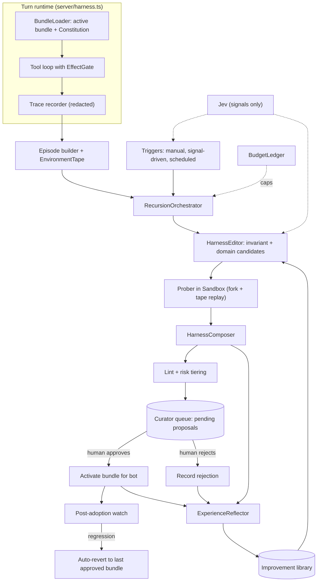
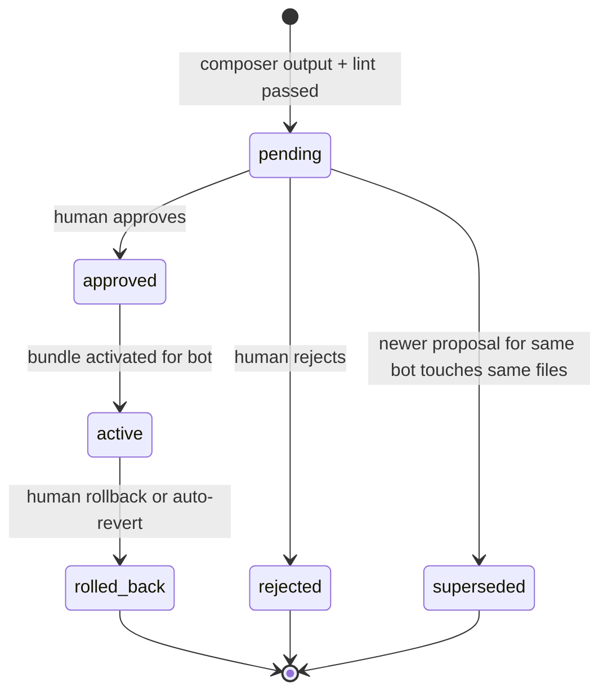
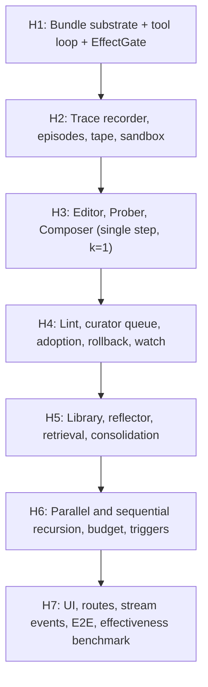

# Recursive Harness Improvement — specification

> **Scope decision (Ali, 2026-10-24):** the whole system is specified and built in one program of work
> (no "reflector-only" first phase), and it runs **local only** (Tauri shell + local Pi Durable
> server, SQLite under `~/.balabot/data/`). Cloudflare `PiHarness` hosting is explicitly **deferred**
> (§17).

## 1. Purpose and non-goals

### 1.1 Purpose

BalaBot agents run on a frozen model. Their quality therefore depends on the **harness** around the
model. This spec adds a mechanism by which an agent's harness is **refined from its own execution
evidence**, and by which the lessons from each refinement persist and guide the next one. It is a
port of the method in Harness² [^harness2-paper] into BalaBot's architecture, adapted to three BalaBot
realities the paper does not face:

1. **Side effects.** Paper tasks are benchmark episodes that can be re-run freely. BalaBot tasks can
   send, spend, delete and publish. Probing therefore requires an effect-aware sandbox (§7).
2. **Human consent.** A bot never approves its own proposal [^project-rules §11]. Every adopted change
   passes a human gate (§9).
3. **Multi-tenancy and secrets.** Lessons and bundles are org-scoped; nothing crosses orgs implicitly,
   and no secret may enter a probe transcript, a library entry or an editor prompt (§13).

### 1.2 Non-goals

- Fine-tuning or changing model weights.
- Editing `personas/<name>/SOUL.md`. The voice is the product's identity [^project-rules §8] and is
  **frozen** (§5.2).
- Auto-adoption of any change without a human decision (§9). Auto-**revert** to a previously
  human-approved bundle is allowed (§9.4).
- Arbitrary agent-written TypeScript plugins in v1 (§5.3, decision D3).
- Cloudflare / Durable Object hosting (§17).

## 2. Evidence base: what the paper establishes

Facts below come from the paper and its repository [^harness2-paper][^harness2-repo]. They are cited so the
design choices in §5–§12 can be traced.

| Finding | Design consequence here |
|---|---|
| Eight editable components: system prompt, guardrails, memory, tool guidance, subagents, skills, scripts, plugins. Four are always-on context; skills load on invoke; scripts run via bash; plugins are middleware outside the model's discretion. | The harness is a **bundle of files** (§4) and the editor is told each component's runtime cost (always-on vs on-demand). |
| Task-level step = Propose (invariant + domain candidates) → Probe (run each candidate on the same task under matched conditions) → Compose (merge, revise, adopt one, or keep current). | The recursion engine (§8). |
| Contrast is evidence of behavior, **not** proof of correctness; stochasticity and shared model bias limit reliability. | Composer must justify each decision by an observation; the human gate is mandatory (§9); evidence fidelity is recorded (§7.4). |
| Harnessing-level recursion: a reflector updates a persistent improvement library with adopted harnesses and evidence-supported lessons; if evidence is insufficient it adds **nothing**. | The improvement library and reflector (§10). "Add nothing" is an explicit, tested outcome. |
| Ablations: removing the library, the scoped (invariant/domain) editors, or composition each lowers scores (3.1/1.8, 2.9/3.7, 1.6/1.9 points on WorkBuddy/JobBench). | All three are required parts of the design — none is optional or deferred. |
| Parallel recursion (k candidates per scope → k compositions) and sequential recursion (k chained steps) with budget `k`; larger `k` helps but costs tokens. | Both modes, with a hard budget ledger (§11). |
| Naive "learn from experience" baselines (ReasoningBank, Harness Scaling) sometimes underperform the base harness. | Unfiltered lesson accumulation is rejected; lessons need evidence and are retrieved selectively (§10.3). |
| Same model can act as executor and editor and still improves. | No separate "strong editor" model is required; model roles are configurable (§8.6). |
| Limitations: recursion cost; weak execution-based signals; library only a simple index (future work: consolidation, adaptive budgets). | Budget caps (§11); library consolidation pass is in scope (§10.4); adaptive stopping is in scope as an early-stop rule (§11.3). |

## 3. Current-state audit (verified 2026-10-24)

Per [^project-rules §3], "exists" is not "shipped". The following was read directly from the repo.

| Needed capability | Current state | Evidence |
|---|---|---|
| System prompt from persona | Present. `loadBotSoul()` concatenates `SOUL.md` + `AGENTS.md` into the system prompt. | `server/harness.ts` `loadBotSoul`, `executeTurn` |
| Tool loop | **Not present** in the turn path read. `generateResponse` issues a streaming chat completion with history; no tool-call loop. | `server/harness.ts` `generateResponse` |
| Skills loaded into a turn | **Not present.** `/api/skills/library` is a stub returning `learned: []` and three hard-coded Shipped tools. | `server/api.ts` `/api/skills/library` |
| Always-on memory file / tool guidance / guardrails as separate components | **Not present.** Only the concatenated persona prompt exists. | `server/harness.ts` |
| Curator (pending → approved) for learned skills | **Not built.** Gap ledger lists the whole learned class as unwired; `docs/STATUS.md` marks curator state missing. | `docs/kb/plans/balabot-gap-ledger.md`, `docs/STATUS.md` |
| Growth audit ledger | Present: `recordGrowthAudit`, table `growth_audit_ledger`. | `server/db.ts` |
| Jev signals (frustration, decision gate) | Present in the turn path. | `server/jev.ts`, `executeTurn` |
| Sub-agent tasks | Present as `pi_tasks` rows. | `server/db.ts` |
| Local tool bridge with jailing | Present. | `server/bridge.ts` |
| Schema owner | `UNIFIED_SCHEMA` in `scripts/migrate_legacy_data.ts`, executed by `BalaBotDatabase`. | `server/db.ts` |

**Implication.** Most of the eight components do not yet exist as runtime concepts. The first deliverable
is therefore not the recursion engine but the **bundle substrate** (§4, wave H1): a bot's turn must be built
from a versioned bundle, with a tool loop that honours effect classes. Until a component has a real call
site that changes model behavior, editing it is a "declared capability, zero effect, no error"
defect [^project-rules §3].

## 4. Data shapes

Per the base rules, the data shapes come first; the modules in §8 follow from them.

```ts
/** Effect class of a tool. Drives probe safety (§7). Declared by the tool, never inferred by the model. */
type EffectClass =
  | "pure"          // no environment access (calculator, formatter)
  | "read"          // reads workspace or network, no mutation
  | "write_local"   // mutates files inside the bot's jailed workspace
  | "external"      // reaches third parties but is reversible/low-stakes (draft, search with side-channel)
  | "irreversible"; // send, spend, delete, publish

/** The eight Harness² components, as BalaBot files. */
type ComponentId =
  | "system_prompt" | "guardrails" | "memory" | "tool_guidance"
  | "skills" | "scripts" | "subagents" | "plugins";

/** A versioned, content-addressed harness. Immutable once written. */
interface HarnessBundle {
  bundleId: string;            // sha256 over the sorted (path, content) pairs
  orgId: string;
  botId: string;
  parentBundleId: string | null;
  createdAt: number;
  files: Record<string, string>; // relative path → content (see layout below)
}

/** One task for refinement: a contiguous request→resolution span in one session. */
interface Episode {
  episodeId: string;
  sessionId: string;
  botId: string;
  fromSeq: number;
  toSeq: number;
  bundleId: string;            // bundle the original run executed under
  workspaceSnapshotHash: string;
  effectProfile: EffectClass[]; // distinct classes the original run touched
}

/** Recorded tool results from the original run, replayed to probes so they see the same world. */
interface EnvironmentTape {
  episodeId: string;
  entries: { key: string; tool: string; effect: EffectClass; resultRef: string }[]; // key = hash(tool, canonical args)
}

interface Execution {
  executionId: string;
  bundleId: string;
  kind: "reference" | "probe" | "composed";
  trace: TraceEvent[];          // messages, tool calls, results (redacted, §13)
  deliverableRef: string | null;
  tokens: { input: number; output: number };
  fidelity: "high" | "medium" | "low"; // §7.4
}

interface Candidate {
  candidateId: string;
  scope: "invariant" | "domain";
  diff: BundleDiff;             // per-file unified diff against the current bundle
  rationale: string;            // must cite trace event ids
  libraryRefs: string[];        // library entries reused or adapted
}

interface BehavioralContrast {
  candidateId: string;
  targetedDeficiency: string;
  verdict: "mitigated" | "unchanged" | "regressed";
  evidence: { eventIds: string[]; note: string }[];
}

interface CompositionDecision {
  action: "merge" | "revise" | "adopt_one" | "keep_current";
  usedCandidates: string[];
  perEditEvidence: { path: string; verdict: "retain" | "drop"; eventIds: string[] }[];
}

/** A refinement outcome awaiting a human (§9). */
interface HarnessProposal {
  proposalId: string;
  runId: string;
  fromBundleId: string;
  toBundleId: string;
  diff: BundleDiff;
  state: "pending" | "approved" | "rejected" | "superseded" | "active" | "rolled_back";
  riskTier: "low" | "medium" | "high"; // §9.2
  decidedBy: string | null;           // a human actor id; never a bot id
}

/** Persistent improvement-library entry (§10). */
interface LibraryEntry {
  entryId: string;
  orgId: string;
  kind: "component" | "experience";
  component: ComponentId | null;
  content: string;
  scope: "invariant" | "domain";
  domainTag: string | null;
  evidence: { runId: string; eventIds: string[] }[]; // required, non-empty
  adoptedCount: number;
  rejectedCount: number;
  retiredAt: number | null;
}
```

### 4.1 Bundle file layout

Mirrors the paper's tree [^harness2-repo] so editor prompts transfer, with BalaBot-specific frozen parts.

```text
<bundle>/
├── systemprompt.md          # C1  ← seeded from personas/<bot>/AGENTS.md
├── guardrails.md            # C2  always-on standing rules
├── LongTermMEMORY.md        # C3  always-on curated domain facts (NOT the holographic store)
├── tool_guidance.md         # C4  always-on tool usage notes
├── skills/<name>/SKILL.md   # C6  loaded on invoke
├── scripts/<name>.<ext>     # C7  invoked through the jailed bridge exec
├── subagents/<name>.md      # C5  delegation definitions (map to pi_tasks roles)
└── plugins/<name>.json      # C8  declarative middleware rules (§5.3)
```

Frozen, never part of a bundle's editable surface (§5.2): `SOUL.md`, the **Constitution** block, and the
effect-class declarations of tools.

Storage: bundles are written to `~/.balabot/data/harness/<org_id>/<bot_id>/bundles/<bundleId>/`
(rows in SQLite hold metadata and hashes). The repo copy under `personas/` remains the source for the
**seed** bundle [^project-rules §8].

## 5. Editable surface and risk

### 5.1 Component table

| Component | Runtime role / cost | Editor may | Risk tier |
|---|---|---|---|
| `systemprompt.md` | Always-on; competes with output budget | Add, tighten, delete lines (small diffs) | medium |
| `guardrails.md` | Always-on | **Add** or tighten only. A lint rejects any edit that removes or loosens a line present in the previously *approved* bundle, unless the human gate explicitly approves that removal | high |
| `LongTermMEMORY.md` | Always-on | Add evidence-linked facts; delete stale ones | medium |
| `tool_guidance.md` | Always-on | Add tool usage notes | low |
| `skills/*` | Invoke-only, zero idle cost | Create, patch | low |
| `scripts/*` | Executed through the bridge | Create, patch | high (executable) |
| `subagents/*` | Delegation | Create, patch | medium |
| `plugins/*.json` | Middleware, outside model's discretion | Create, patch (declarative DSL only) | high |

The editor prompt must state the always-on vs on-demand cost, as in the paper, and prefer on-demand
components (skills, scripts, plugins) when an always-on edit would do the same job.

### 5.2 Frozen layer (the Constitution)

A fixed block injected **after** the bundle content on every turn and never editable by the improvement
system. It encodes the non-negotiables from [^project-rules]: secrets never printed or stored; consent before
creation; irreversible actions keep a real reasoner; Jev is infrastructure and fails loud; NEVER THE HOST;
no cross-org access. A bundle edit that contradicts the Constitution is rejected at lint time (§9.3), and
the Constitution wins at runtime if one slips through.

### 5.3 Plugins: decision D3

The paper's plugins are arbitrary middleware code. `node:vm` is **not** a security boundary, and BalaBot has
no sandboxed JS runtime locally. In v1 a plugin is a **declarative rule**, not code:

```json
{ "id": "confirm-bulk-delete", "on": "pre_tool", "match": { "tool": "exec", "argsRegex": "rm\\s+-r" },
  "action": "require_confirmation", "reason": "Recursive delete" }
```

Allowed actions: `block`, `require_confirmation`, `annotate_result`, `truncate_result`, `retry_once`.
This preserves the paper's key property (acts in the loop, outside the model's discretion) without letting the
editor ship executable code. Arbitrary TypeScript plugins stay out of scope until a real sandbox exists
(CONCERN: revisit when the Rust shell can host an isolated runtime).

## 6. Architecture overview



## 7. Probe safety: the effect-aware sandbox

This is the part with no analogue in the paper and the main safety obligation of the design.

### 7.1 Effect classes and the EffectGate

Every tool declares an `EffectClass` in code. The `EffectGate` sits between the tool loop and the tool
implementation and enforces the execution mode:

| Mode | `pure` | `read` | `write_local` | `external` | `irreversible` |
|---|---|---|---|---|---|
| `live` (normal turn) | run | run | run (jailed) | run, subject to consent policy | run, requires human consent + real reasoner |
| `probe` | run | **tape first**, then live read-only | run against a **copy-on-write workspace clone** | **stubbed** | **stubbed** |

A stub returns a synthetic result flagged `{ dryRun: true, intent: {tool, args} }` and records the intended call
into the trace. **No probe ever performs an `external` or `irreversible` effect.** A tool without a declared
`EffectClass` is treated as `irreversible` (fail closed).

### 7.2 Workspace clone

Probes run in a clone of the workspace snapshot recorded on the `Episode`
(`workspaceSnapshotHash`), under `~/.balabot/data/harness/probes/<runId>/<probeId>/`, inside the same
jail rules as `server/bridge.ts` (directory jailing, NEVER THE HOST). Clones are deleted after the run;
only the trace and the deliverable reference remain.

### 7.3 Environment tape

Matched conditions require the candidate to see the world the reference saw. While the original run executes
(live mode), the recorder stores each `pure`/`read`/`external-read` result keyed by
`hash(tool, canonical args)`. During a probe, a tool call whose key is on the tape is answered from the tape
(deterministic). A call not on the tape is: allowed live if `read` and the probe has not exhausted its live-read
allowance; otherwise stubbed. Tape entries are redacted at write time (§13).

### 7.4 Fidelity label

Each `Execution` gets `fidelity`:

- `high`: every tool call hit the tape or ran as a permitted live read; deliverable produced.
- `medium`: some calls were stubbed but none changed what the deliverable depends on (judged by the Composer
  from the trace, recorded as an assumption).
- `low`: key calls (an `irreversible` outcome the task depends on) were stubbed.

The Composer may only `adopt_one` / `merge` edits whose supporting probe has `fidelity` ≥ `medium`. A `low`
run can still yield a **proposal** but it is capped to risk tier `high` and displayed to the human with the
fidelity badge. This keeps the paper's caution that contrast is evidence, not verification.

## 8. Recursion engine

Modules live under `server/harness/` (new directory, §15 for file ownership).

### 8.1 Triggers

An improvement **run** starts from an `Episode`. Triggers:

1. **Manual:** the owner clicks "Improve this" on a session or calls the API (§12).
2. **Signal-driven (opt-in per bot):** after a session settles, an episode qualifies when at least one holds —
   a Jev frustration signal ≥ 0.6 in the span, a user rejection of an approval card, a tool error, or a
   "no" to a done-check. Jev classifies; it does not decide that a run happens — the BudgetLedger and the
   per-bot opt-in do.
3. **Scheduled (opt-in):** a local nightly sweep picks the highest-signal unprocessed episodes within the
   daily budget. Uses the existing in-memory Pi scheduler.

Default for a new bot: **all automatic triggers off**; manual only.

### 8.2 Reference execution

The original run is the reference: its trace is `e0`, and it is the source of the environment tape. This costs
no extra tokens. An option `freshReference: true` re-runs the current bundle in probe mode instead, to
measure run-to-run noise. This is a deliberate deviation from the paper, which samples a new reference;
it is justified because the original run is real and already paid for.

### 8.3 Propose

The `HarnessEditor` is invoked twice with separate prompts, per the paper's scoped editors:

- **Invariant editor:** reads the trace for deficiencies that recur across domains (planning, tool use,
  context management, delegation, verification-before-done).
- **Domain editor:** reads the trace for knowledge, procedures and constraints specific to this task's domain.

Inputs: the episode, the current bundle, the reference trace, earlier run history for this bot, and the
Jev-re-ranked top library entries (§10.3). Output: a `Candidate` per scope with per-file diffs. Every
rationale must cite trace event ids; a candidate whose rationale cites no event is dropped at validation.
Task-specific facts from library entries must be re-checked against this episode's evidence.

Prompts are stored as versioned files in the repo (`server/harness/prompts/`), derived from, and credited to, the
paper's appendix prompts [^harness2-repo], and adapted to BalaBot components. They are fixed: the paper's
decision rule and stage instructions do not change between tasks.

### 8.4 Probe

Each candidate bundle is materialised and run through the same tool loop in `probe` mode (§7) against the
episode's inputs, with the same model and, where the provider supports it, the same seed. The `Prober` produces
a `BehavioralContrast` per candidate by comparing its trace to `e0`: did the targeted deficiency recur, was it
mitigated, did anything regress. The contrast is produced by a judge call whose prompt forbids claiming
correctness — only behavioral difference.

### 8.5 Compose

The `HarnessComposer` reads: the reference, every candidate and its diff, all contrasts, and the task-local
evidence. It returns a `CompositionDecision` with one of `merge`, `revise`, `adopt_one`, `keep_current`, with each
retained or dropped edit tied to specific event ids. The composed bundle is itself executed once in probe mode
(`kind: "composed"`) to confirm it runs; a composed bundle that fails to run is discarded and the decision
falls back to `keep_current`.

`keep_current` is a valid, first-class outcome and produces no proposal.

### 8.6 Recursion modes and budget `k`

| Mode | Behavior |
|---|---|
| `parallel` | `k` invariant + `k` domain candidates probed concurrently; `k` compositions from the shared evidence; a final selection among compositions |
| `sequential` | `k` chained Propose–Probe–Compose steps; each starts from the previous composed bundle and carries accumulated evidence |

Default `k = 2`, mode `parallel`. The improvement library is **read-only during a run** and only updated by
the reflector afterward (the paper holds it fixed during task-level recursion).

Model roles (`executor`, `editor`, `judge`, `composer`, `reflector`) are configured per bot with fallback to the
bot's model. The paper shows the same model works for all roles [^harness2-paper]; no stronger model is required.
If no model is configured or reachable, the run ends with `available: false` and a stated reason. There is no
fabricated or heuristic editor in production paths [^project-rules §10]. Deterministic editors exist only as
test fixtures (§16).

## 9. Curator gate and adoption

### 9.1 Proposal lifecycle



A proposal is never `approved` by a bot actor. The approve route rejects any actor id that resolves to a bot
([^project-rules §11] "a bot never approves its own proposal").

### 9.2 Risk tiers and review requirements

| Tier | Triggered by | Review |
|---|---|---|
| low | only `tool_guidance.md` or new/patched skills | single-click approve with diff |
| medium | `systemprompt.md`, `LongTermMEMORY.md`, `subagents/*` | diff + the per-edit evidence panel shown by default |
| high | any `guardrails.md` change, `scripts/*`, `plugins/*`, any `low`-fidelity-supported edit, or any removal | diff + evidence + explicit typed confirmation; scripts show a dry-run listing of what they would execute |

Per-edit approval is supported: the human may approve a subset of file diffs; the remainder is dropped and
recorded as rejected.

### 9.3 Lint (pre-queue, blocking)

A proposal is blocked, not queued, if any holds:

- A secret pattern appears in any file (§13).
- An edit removes or weakens a Constitution clause or a previously approved guardrail without being tagged as a
  removal request.
- A skill or script references a tool with no declared `EffectClass`.
- A plugin rule uses an action outside the allowed set (§5.3).
- A file is outside the bundle layout, or targets `SOUL.md`.
- Always-on files grew beyond a configured size ceiling (default: +1,500 characters per proposal, 12,000 total)
  — the paper's own prompts call the always-on cost the costliest failure mode.

### 9.4 Post-adoption watch and revert

For each activated bundle the system tracks, over the next `N` qualifying episodes (default 10), the rates of
Jev frustration signals, approval rejections, tool errors, and steps-per-episode, against the same
metrics for the previous bundle's window. If frustration or tool-error rate worsens beyond a configured margin
the system **auto-reverts to the previous approved bundle**, records the reason in `growth_audit_ledger`, and
notifies the owner. Auto-revert is safe because it only restores a human-approved state. It never
creates a new state.

### 9.5 Promotion

An adopted bundle is scoped to **one bot**. Promoting a skill to org-shared is a separate explicit human action
matching the existing learned → org-shared promotion model [^org-secrets-and-skills]. Cross-org promotion is not
supported.

## 10. Improvement library and reflector

### 10.1 Contents

Two entry kinds, as in the paper: **component** entries (a reusable skill, guidance snippet, script or plugin
rule that was adopted) and **experience** entries (a lesson about when and why an edit did or did not work).
Every entry requires non-empty `evidence` (run id + trace event ids). An entry with no evidence is not
written.

### 10.2 Reflector

After every run, including `keep_current`, **rejected** and **rolled-back** outcomes, the `ExperienceReflector`
reads the run record and the human decision and returns zero or more entries. Rejections matter: a rejected
edit becomes an experience entry (`rejectedCount++`) so the editor stops proposing it. When evidence is
insufficient the reflector returns an empty list and the run records `reflection: "none"`.

### 10.3 Retrieval

At Propose time the library is queried by component, scope and domain tag, then ranked. Jev scores
relevance of each candidate entry against the episode state (typed Score/Noul question over a closed set,
which matches the Jev trigger test). If Jev is unreachable the run **fails loud** with a stated reason; in
`JEV_MODE=heuristic` the existing offline engine is used, as already allowed by the PRD. Entries are inserted as
reusable material, never auto-inherited into the bundle.

### 10.4 Consolidation (paper's future-work item, in scope)

A scheduled local pass, also manually triggerable, merges overlapping entries, retires entries whose
`rejectedCount` dominates, and flags entries contradicted by newer adopted ones. Retired entries keep their
evidence and are marked `retiredAt`; **nothing is deleted** (matches the curator's never-delete rule in
[^remaining-build-plan]).

### 10.5 Org scoping

Entries carry `org_id`. Retrieval never crosses orgs. The paper's cross-benchmark transfer result informs a
possible future "explicit, named, revocable grant" for library sharing, consistent with the cross-org grant
rule [^project-rules §11]; it is not built here.

## 11. Budget and cost control

### 11.1 BudgetLedger

Every model call made by the improvement system (editor, probe execution, judge, composer, reflector,
consolidation) records tokens and wall-clock against the run, bot and day. Caps, all configurable:

| Cap | Default (proposal, to tune) |
|---|---|
| Per run tokens | 1.5 M |
| Per bot per day tokens | 4 M |
| Concurrent probes | 3 |
| Max `k` | 5 |

A cap hit ends the run as `budget_exhausted` and records partial evidence; no partial proposal is queued.

### 11.2 Visibility

The run timeline and a per-bot budget panel show tokens spent and the share spent on probes vs execution,
following the paper's compute–performance analysis [^harness2-paper].

### 11.3 Early stop (paper's adaptive-recursion item, in scope)

In `sequential` mode, a step whose Compose decision is `keep_current` ends the chain. In `parallel` mode,
if every probe returns `unchanged`, remaining compositions are skipped.

## 12. Interfaces

### 12.1 HTTP routes (added to `server/api.ts`)

| Route | Purpose |
|---|---|
| `POST /api/harness/runs` | Start a run for `{ sessionId, fromSeq, toSeq, k, mode }` |
| `GET /api/harness/runs` / `GET /api/harness/runs/:id` | List / read run timeline, candidates, contrasts, decision |
| `POST /api/harness/runs/:id/cancel` | Cancel a running run |
| `GET /api/harness/proposals` | Curator queue (filter by bot, state, tier) |
| `GET /api/harness/proposals/:id` | Diff, evidence, fidelity |
| `POST /api/harness/proposals/:id/approve` | Human approve (whole or per-file) |
| `POST /api/harness/proposals/:id/reject` | Human reject, with optional reason fed to the reflector |
| `POST /api/harness/bots/:botId/rollback` | Revert to a prior approved bundle |
| `GET /api/harness/library` | Library entries (filter, include retired) |
| `GET /api/harness/budget` | Ledger totals |
| `GET/PATCH /api/harness/bots/:botId/settings` | Opt-ins, `k`, mode, caps, model roles |

Existing route to fix: `/api/skills/library` must return real `learned` skills from the active bundle instead of
the current stub, and report `available: false` with a reason where state does not exist.

### 12.2 Stream events

A new `event: harness` on the existing stream carries `{ type: "run_started" | "candidate_proposed" |
"probe_finished" | "composed" | "proposal_queued" | "run_ended" | "budget_exhausted" | "reverted", ... }`.

### 12.3 UI

- **Curator queue** view: pending proposals with diff, per-edit evidence, fidelity badge, risk tier, approve/
  reject/partial-approve.
- **Run timeline**: reference → candidates → contrasts → composition, with trace event links.
- **Library** view: entries with evidence and retire status.
- **Bot settings**: opt-ins, budget, `k`, model roles.
- Approvals use the OpenUI card mechanism (`ConfirmButtons`) in chat for the "I noticed a recurring problem,
  want me to look into it?" prompt [^project-rules §13]. The agent never silently improves itself.

## 13. Security, secrets and privacy

- **Redaction at write time.** Traces, tapes, library entries and editor prompts pass the same redaction used
  for chat. Known secret values from the vault are matched by fingerprint and replaced with `[SECRET:<name>]`
  [^project-rules §5]. A secret that nonetheless lands in a trace burns that trace: delete it, rotate the secret,
  and say so.
- **No secret reaches an editor or judge prompt.** The editor sees redacted traces only.
- **Probe isolation.** No network egress except permitted live `read` calls; no host input injection;
  workspace clone jail (§7).
- **Lint** blocks secret patterns in any bundle file (§9.3).
- **Org scoping** on every table and path.
- **Human gate** cannot be bypassed by bot actors; the approve path verifies actor type.
- **Auditability.** Every adoption, rejection, rollback and auto-revert writes `growth_audit_ledger`.

## 14. Data model (SQLite)

New tables are added through `UNIFIED_SCHEMA` (`scripts/migrate_legacy_data.ts`), the existing schema owner.
All carry `org_id`.

| Table | Key columns |
|---|---|
| `harness_bundles` | `bundle_id`, `org_id`, `bot_id`, `parent_bundle_id`, `path`, `created_at` |
| `harness_bot_state` | `bot_id`, `active_bundle_id`, `previous_approved_bundle_id`, settings JSON |
| `harness_episodes` | `episode_id`, `session_id`, `from_seq`, `to_seq`, `bundle_id`, `workspace_snapshot_hash`, `tape_path` |
| `harness_runs` | `run_id`, `episode_id`, `mode`, `k`, `state`, `trigger`, `reflection`, timestamps |
| `harness_executions` | `execution_id`, `run_id`, `bundle_id`, `kind`, `fidelity`, `trace_path`, token counts |
| `harness_candidates` | `candidate_id`, `run_id`, `scope`, `diff_json`, `rationale`, `library_refs` |
| `harness_contrasts` | `candidate_id`, `verdict`, `evidence_json` |
| `harness_decisions` | `run_id`, `action`, `per_edit_json` |
| `harness_proposals` | `proposal_id`, `run_id`, `from_bundle_id`, `to_bundle_id`, `state`, `risk_tier`, `decided_by`, `decided_at` |
| `harness_library` | `entry_id`, `org_id`, `kind`, `component`, `scope`, `domain_tag`, `content`, `evidence_json`, `adopted_count`, `rejected_count`, `retired_at` |
| `harness_budget_ledger` | `run_id`, `bot_id`, `day`, `role`, `tokens_in`, `tokens_out`, `wall_ms` |
| `harness_watch` | `bundle_id`, `window_n`, `metrics_json`, `verdict` |

Each `pi_messages` row also needs the `bundle_id` the turn ran under. This is a column addition in
`UNIFIED_SCHEMA`, and the reference run depends on it.

Local file layout under `~/.balabot/data/harness/`: `<org>/<bot>/bundles/`, `<org>/<bot>/tapes/`,
`<org>/<bot>/traces/`, `probes/` (ephemeral).

## 15. Code layout and file ownership

Per [^project-rules §4], one owner per file per wave. Contested existing files and the hooks they need,
which each owner receives as exact text rather than being edited by a sibling:

| Existing file | Hook required | Owner |
|---|---|---|
| `server/harness.ts` | Build the turn from `BundleLoader` instead of `loadBotSoul`; route model tool calls through a tool loop that applies `EffectGate`; stamp `bundle_id` on messages; emit trace events to the recorder | harness-core |
| `scripts/migrate_legacy_data.ts` (`UNIFIED_SCHEMA`) | New tables and `pi_messages.bundle_id` | schema |
| `server/api.ts` | Routes (§12.1) and the `/api/skills/library` fix | api |
| `server/db.ts` | Accessors for new tables | schema |
| `ui/src/*` | Curator, run timeline, library, settings views | ui |

New modules (single owner each, no existing file edited): `server/harness/bundle.ts`, `effects.ts`,
`sandbox.ts`, `tape.ts`, `editor.ts`, `prober.ts`, `composer.ts`, `reflector.ts`, `library.ts`, `lint.ts`,
`curator.ts`, `budget.ts`, `watch.ts`, `recursion.ts`, and `prompts/`.

## 16. Verification

Per [^project-rules §3, §6], shipped means a real call site, **at least 15 real-ability scenarios**, an E2E
run through the UI, and a mutation check showing the harness can fail. The model-backed scenarios use the
real model path; deterministic editor fixtures are allowed **only** to test orchestration, never to claim
quality gains.

### 16.1 Required scenarios (≥15)

1. A turn built from a bundle observably uses `guardrails.md` (a guardrail changes behavior; removing it
   changes it back).
2. Same for `LongTermMEMORY.md`, `tool_guidance.md`, and an invoked skill (one scenario each).
3. A declarative plugin `require_confirmation` rule stops an `exec` call outside the model's discretion.
4. A tool with no declared `EffectClass` is stubbed in probe mode and refused for auto-approval.
5. A probe run never performs an `external` or `irreversible` call; the stub records the intent.
6. A probe sees tape results for a repeated `read`; a non-taped `read` beyond allowance is stubbed.
7. `write_local` in a probe mutates only the clone; the live workspace hash is unchanged.
8. The invariant and domain editors each produce a candidate citing event ids; a candidate with no citation is
   dropped.
9. Composer returns `keep_current` when contrasts show `unchanged`/`regressed`; no proposal is queued.
10. Composer `merge` keeps supported edits and drops an unsupported one, each tied to event ids.
11. A `low`-fidelity-supported edit is capped to high risk and badged.
12. Lint blocks a secret in a candidate skill; lint blocks removal of an approved guardrail.
13. A bot actor calling approve is refused; a human actor succeeds; approve activates the bundle.
14. Per-file partial approval activates only the approved files and records the rest as rejected.
15. A rejection is reflected into an experience entry and the editor's next run is given it.
16. Reflector with insufficient evidence writes **no** entry.
17. Budget cap mid-run ends as `budget_exhausted`, queues no proposal, keeps partial evidence.
18. Post-adoption watch detects a worsened tool-error rate and auto-reverts to the previous approved bundle,
    with an audit row.
19. Library retrieval never returns another org's entries.
20. Jev unreachable (cloud mode) fails the run loud with a reason; heuristic mode proceeds.
21. `/api/skills/library` returns real adopted skills as `learned`, and `available:false` with a reason when
    state is missing.
22. Crash mid-run: restarting resumes or marks the run `interrupted` with no half-written bundle activated.

### 16.2 Mutation checks (the harness must be shown able to fail)

For each, remove or invert the gate, confirm the named test fails, restore:

- Remove the `EffectGate` probe stubbing → scenario 5 fails.
- Remove the human-actor check on approve → scenario 13 fails.
- Remove the secret lint → scenario 12 fails.
- Make the reflector always write an entry → scenario 16 fails.
- Make the Composer ignore fidelity → scenario 11 fails.
- Disable org filter in library retrieval → scenario 19 fails.

### 16.3 E2E

A UI-driven run: a seeded session with a recurring procedural failure → "Improve this" → run timeline completes →
proposal appears in the curator queue with diff and evidence → human approves → next turn demonstrably
uses the new skill/guardrail → rollback restores the prior behavior. Real model, real tool loop, local server.

### 16.4 Effectiveness measurement

Behavioral gain is **not** assumed. A local benchmark of at least 10 recorded episodes per target bot
(organisation-provided, replay-safe) is run with and without the adopted bundle, matched model, `k` as
configured, three repetitions, mean and spread reported. A claim of improvement is made only with that
output. Failure to improve is an acceptable, reported result.

## 17. Deferred: Cloudflare

Out of scope for this program: `PiHarness` DO hosting of the recursion engine, Durable Object alarms for
the scheduled sweep, DO-SQLite storage of bundles and library, and cross-device state sync. The design is
kept portable: modules depend on a storage interface and a scheduler interface, not on `better-sqlite3`
paths. Revisit after local acceptance.

## 18. Build program (all of it, sequenced)

All waves are in scope. Sequencing exists because later waves depend on earlier substrate, not because
anything is optional. Each wave ends with a call-site check before it is called shipped.



| Wave | Delivers | Exit check |
|---|---|---|
| H1 | `BundleLoader`, seed bundle from `personas/`, Constitution, tool loop in `executeTurn`, `EffectGate` with declared classes, `bundle_id` on messages, declarative plugins | Scenarios 1–4 |
| H2 | Redacted trace recorder, `Episode` builder, `EnvironmentTape`, workspace clone | Scenarios 5–7 |
| H3 | `HarnessEditor` (two scopes), `Prober`, `HarnessComposer`, fidelity labels, single-step orchestration | Scenarios 8–11 |
| H4 | Lint, curator queue state machine, risk tiers, human-actor check, partial approval, activation, rollback, post-adoption watch, `/api/skills/library` fix | Scenarios 12–14, 18, 21 |
| H5 | Library tables, reflector (incl. rejections), Jev-re-ranked retrieval, org scoping, consolidation | Scenarios 15, 16, 19, 20 |
| H6 | Parallel and sequential modes with `k`, `BudgetLedger`, early stop, signal and scheduled triggers, crash recovery | Scenarios 17, 22 |
| H7 | HTTP routes, `harness` stream events, UI views, OpenUI consent card, E2E, mutation checks, effectiveness benchmark | §16.2–§16.4 |

## 19. Decisions and risks

### 19.1 Decisions proposed in this spec (veto welcome)

| ID | Decision | Alternative |
|---|---|---|
| D1 | The original run is the reference execution (reuses tokens, supplies the tape). | Fresh reference every time (paper default; costlier, measures noise) |
| D2 | `SOUL.md` frozen; Constitution frozen. | Allow voice evolution under stricter review |
| D3 | Plugins are a declarative rule DSL, not code. | Arbitrary TS plugins (needs a sandbox we do not have) |
| D4 | Auto-revert to the previous *approved* bundle is allowed without a human. | Require a human for every revert |
| D5 | All automatic triggers default **off** per bot. | Signal-driven on by default |
| D6 | Per-bot scope; org-shared promotion is a separate explicit action. | Org-wide adoption by default |
| D7 | Prompts derived from the paper's appendix prompts, versioned in-repo. | Author prompts from scratch |

### 19.2 Risks

- **CONCERN — weak evidence.** Contrasts are noisy; a regressing edit can still look good on one episode.
  Mitigations: fidelity labels, mandatory human gate, post-adoption watch, revert. Residual risk remains.
- **CONCERN — replay fidelity.** Tasks dominated by `irreversible` effects can only be probed at `low` fidelity.
  Those bots will mostly get high-risk proposals or `keep_current`.
- **CONCERN — cost.** `k = 5` parallel is on the order of 11+ model sessions per run. Defaults are conservative
  and caps are hard.
- **CONCERN — always-on bloat.** Always-on files grow with adoption. The size ceiling and consolidation
  pass are the control; monitor.
- **CONCERN — the substrate is the real work.** The tool loop, effect classes and bundle loader (H1) do not exist
  today; most of the schedule risk is there, not in the recursion logic.
- **CONCERN — license.** The paper's reference code is Apache-2.0 [^harness2-repo]. Prompts adapted from it need
  attribution and a NOTICE entry before they ship.

### 19.3 Open questions

1. Confirm D1–D7, especially D3 (plugins as DSL) and D4 (auto-revert).
2. Which bots are the first effectiveness-benchmark targets, and who supplies replay-safe episodes?
3. Default model roles: same model as the bot, or a fixed editor model for cost predictability?

[^harness2-paper]: Harness²: Recursive Agent Harnessing for an Open World, arXiv:2610.14224.
[^harness2-repo]: https://github.com/google-research/harness2 (Apache-2.0).
[^project-rules]: `docs/PROJECT-RULES.md`.
[^org-secrets-and-skills]: `docs/kb/plans/org-secrets-and-skills.md`.
[^remaining-build-plan]: `docs/kb/plans/balabot-remaining-build-plan.md`.
