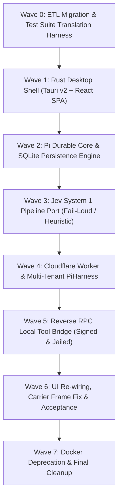

# BalaBot — Pi Durable & Cloudflare Migration Build Plan

> **MASTER SPEC COMPLIANCE:** This build plan ratifies the transition from Hermes to **Pi Durable** (`@earendil-works/pi-durable`)[^pi-dev] and **Cloudflare Agents SDK (`PiHarness`)**[^cf-agents-docs], eliminating Docker entirely while preserving 100% of the BalaBot user interface, hierarchy, personas, Jev System 1 intelligence, and OKF governance ledger[^prd-pi-durable].

## The Eight Migration Waves

### Wave 0: ETL Migration & Test Suite Translation
* **Goal:** Zero data loss for existing users and full regression coverage before decommissioning Python.
* **Deliverables:**
  - Automated migration ETL script (`scripts/migrate_legacy_data.ts`) to extract and transform `/opt/data/` stores (`continuity.db`, `queue.db`, `handoffs.db`, `fleet/bots.json`, `/opt/data/groups/`) into the unified `pi_*` schema.
  - Translate the 527 existing Python `pytest` tests into native TypeScript/Rust integration tests (`vitest` / `cargo test`).
* **Verification:** Run ETL against snapshot legacy data with 100% field preservation; test harness runs and passes before backend code removal.

### Wave 1: Rust Desktop Shell (`src-tauri/`)
* **Goal:** Zero-dependency native distribution replacing Docker Desktop and WSL2.
* **Deliverables:**
  - Initialize Tauri v2 application wrapping `ui/dist`.
  - Native window chrome, system tray, and OS shortcuts (`Cmd/Ctrl+K`, `Cmd/Ctrl+D`).
  - Runtime Mode Switcher: toggle between `Local PC Server` and `Cloudflare Remote Server`.
  - Embed lightweight V8/Node execution runner sidecar for local Pi Durable engine.
* **Verification:** App compiles to native bundle (~120 MB package with embedded runtime) and launches UI with ~150 MB RAM active footprint.

### Wave 2: Pi Durable Core & SQLite Engine
* **Goal:** Replace Hermes gateway process with `@earendil-works/pi-durable` and unified relational persistence.
* **Deliverables:**
  - Implement unified SQLite schema: `pi_sessions` (with `bot_id`, `purpose`), `pi_messages` (with `thinking`, `tool_calls`), `pi_tasks`, `pi_inbox` (absorbing queues/handoffs), `topic_spans`, `session_decisions`, `pi_orgs`, `pi_groups`, `group_messages`.
  - Wire `@earendil-works/pi-ai` for multi-provider LLM support.
  - Implement atomic pre-execution journaling for zero-loss crash recovery and on-demand context pruning.
* **Verification:** Kill app process mid-turn during streaming; restart and prove turn resumes without data loss or corruption.

### Wave 3: Jev Continuity & Sensor Pipeline
* **Goal:** Port Jev System 1 calibrated probabilistic evaluator (`POST https://api.typesafe.ai/v1/systemone`).
* **Deliverables:**
  - Keyword dictionary detector triggering Jev Noul question: `"is this user frustrated?"`.
  - Decision gate evaluating: `"does this message establish or record a binding decision?"`.
  - Memory relevance re-ranker on Holographic SQLite prefetch.
  - Cloud fail-loud verification (`JEV_MODE=cloud`) and offline deterministic heuristic fallback (`JEV_MODE=heuristic`).
* **Verification:** Synthetic decision and frustration scenarios match ground truth; missing key halts cleanly in cloud mode; offline heuristic functions cleanly.

### Wave 4: Cloudflare Workers & Agent Pi (`PiHarness`)
* **Goal:** Deploy serverless edge agent host on Cloudflare Workers and Durable Objects.
* **Deliverables:**
  - Configure multi-tenant `BalaBotAgent` extending `DurableObject<Env>` partitioned by `${tenant_id}:${org_id}:${bot_id}`.
  - Install `Lifecycle` with `PiHarness` (`agents/harness/pi`).
  - Map SQLite storage to co-located Durable Object SQLite (`this.sql`) with `pi_*` prefix.
  - Wire Lifecycle alarms to Pi's `wake()` scheduler for automatic cold-start recovery.
* **Verification:** Deploy to Cloudflare; connect via WebSocket; execute multi-turn conversation across edge worker evictions.

### Wave 5: Reverse RPC Local Tool Bridge
* **Goal:** Allow Cloudflare-hosted agents to execute commands on the user's PC with consent and strict containment.
* **Deliverables:**
  - WebSocket JSON-RPC channel with Ed25519 request signing between Cloudflare Worker and local Rust client.
  - Registered parameter-validated tools: `local_exec`, `local_read`, `local_write`, `local_screen`.
  - Workspace directory jailing and interactive approval prompts for sensitive actions.
  - Enforce "NEVER THE HOST" Desktop Law: automation targets headless Chromium CDP or virtual framebuffers only.
* **Verification:** Cloudflare agent executes safe git status inside designated workspace; host desktop input injection is provably blocked.

### Wave 6: UI Re-wiring & Acceptance Verification
* **Goal:** End-to-end integration and verification of all UI components.
* **Deliverables:**
  - OpenUI Generative UI card rendering (`HireAgentCard`, `ConfirmButtons`).
  - Thinking stream disclosure toggle (`choices[].delta.reasoning_content`).
  - Human intervention take-over card (`InterventionCard.tsx`).
  - Fix carrier text leak in `ui/src/api.ts` `handleFrame` (`event: jev_carrier`).
  - Run translated 527-test regression suite + E2E scenarios.
* **Verification:** 100% of translated tests pass; 15/15 real-world user scenarios pass through the native desktop app.

### Wave 7: Docker Deprecation & Final Cleanup
* **Goal:** Total removal of Docker artifacts and container-bound legacy code.
* **Deliverables:**
  - Remove `Dockerfile`, `docker-compose.yml`, `entrypoint.sh`, and `docker/` directory.
  - Migrate legacy file paths (`/opt/data/*` → OS app data directories).
  - Update `docs/STATUS.md` and repository README.
* **Verification:** Repository tree contains zero references to Docker containers or s6-overlay.

[^prd-pi-durable]: [Product Requirements Document (PRD): BalaBot Modernization](../../PRD-PI-DURABLE.md)
[^cf-agents-docs]: [Cloudflare Agents Documentation](https://developers.cloudflare.com/agents/)
[^pi-dev]: [Pi Minimal Extensible Agent Harness](https://pi.dev/)
